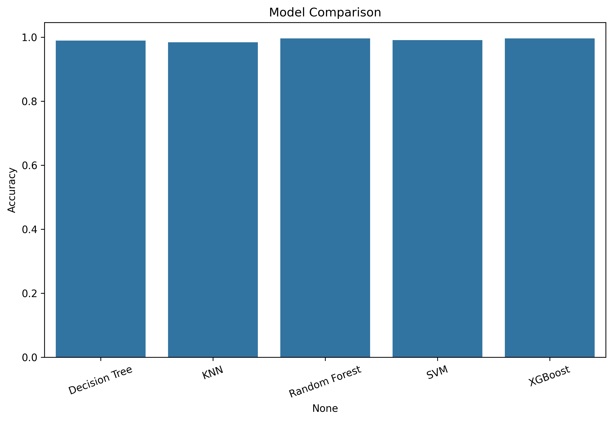
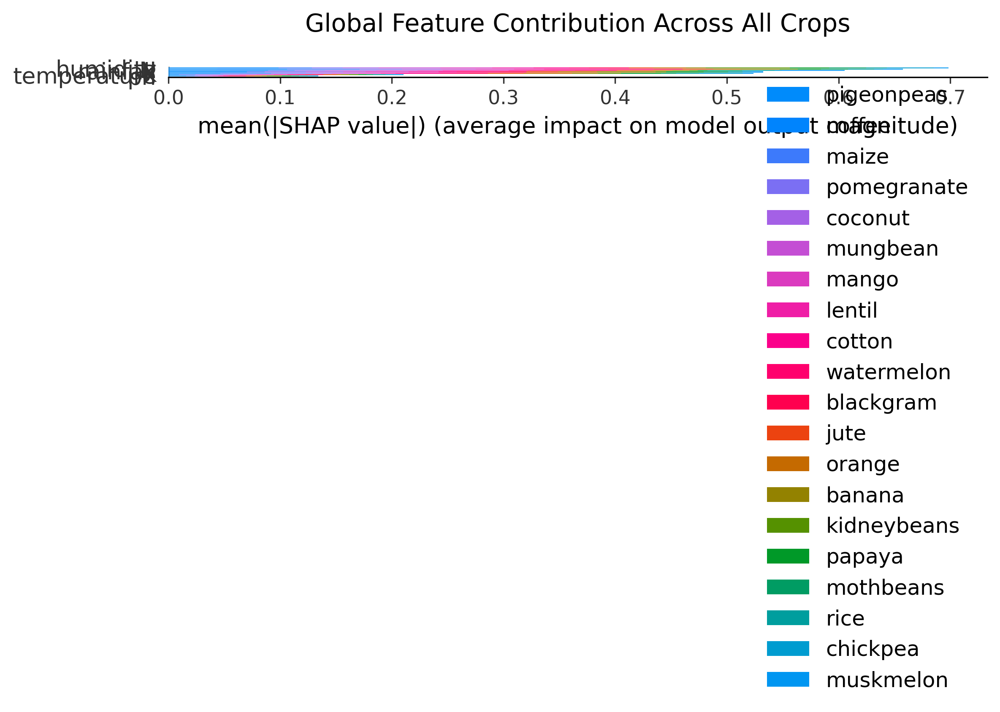
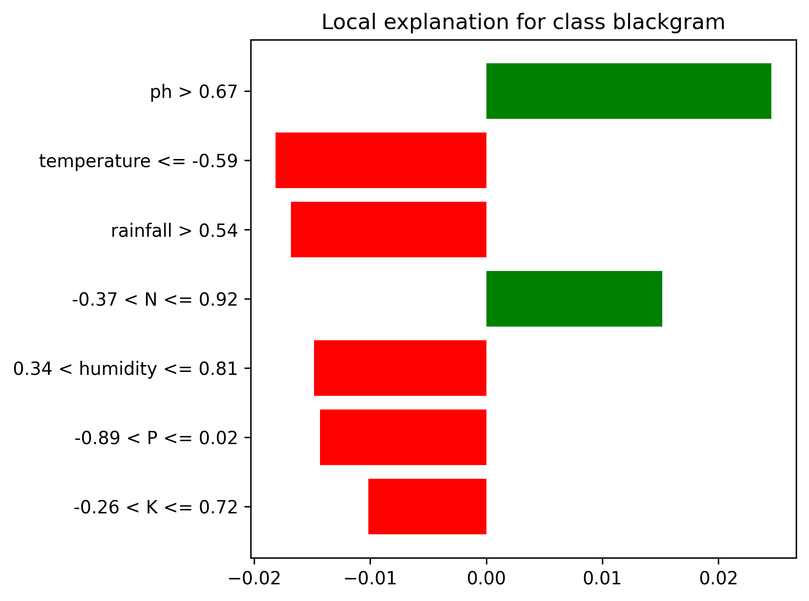
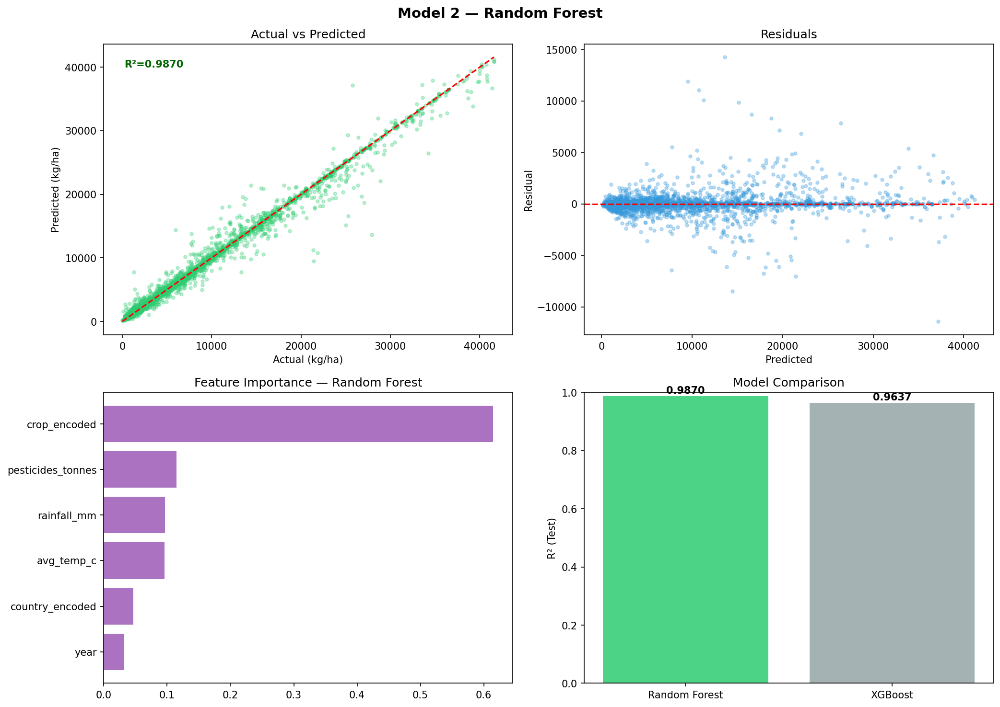

# 🌾 AgroAI — Explainable AI for Crop Recommendation & Yield Prediction

[](https://github.com/MehdiR20/agroai-xai/actions/workflows/ci.yml)


> Master's thesis project (M.Sc. Software Engineering, Université Saad Dahlab de Blida).

AI-powered cascade pipeline that recommends the best crop for a farm location and predicts its yield using real-time IoT-style data.

---

## 🏗️ System Architecture

```
┌─────────────────┐    ┌─────────────────┐    ┌─────────────────┐
│   Soil Data     │    │  Weather Data   │    │   User Input    │
│  (SoilGrids)    │    │  (Open-Meteo)   │    │  (Pesticides)   │
└────────┬────────┘    └────────┬────────┘    └────────┬────────┘
         └──────────────────────┴──────────────────────┘
                                │
                  ┌─────────────▼─────────────┐
                  │   MODEL 1                 │
                  │   Crop Recommendation     │
                  │   (Classification)        │
                  └─────────────┬─────────────┘
                                │ (recommended crop)
                  ┌─────────────▼─────────────┐
                  │   MODEL 2                 │
                  │   Yield Prediction        │
                  │   (Regression)            │
                  └─────────────┬─────────────┘
                                │
                       ┌────────▼────────┐
                       │  Streamlit UI   │
                       │  (3 languages)  │
                       └─────────────────┘
```

---

## 📁 Project Structure

```
agroai-xai/
├── datasets/
│   ├── Crop_recommendation.csv           # original dataset
│   ├── Crop_recommendation_augmented.csv # used to train Model 1
│   └── yield_df.csv                # for Model 2
├── models/                         # generated by training (not committed)
├── figures/                        # auto-generated plots
│
├── train_model1_crop.py  # Train Model 1 (classification + SHAP/LIME)
├── train_model2_yield.py # Train Model 2 (regression)
├── api_services.py       # SoilGrids + Open-Meteo helpers
├── translations.py       # EN / FR / AR translations
├── app_cascade.py        # Streamlit dashboard
├── xai/                  # SHAP vs LIME comparison tables
├── tests/                # pytest unit tests
└── requirements.txt
```

---

## 🚀 Setup

### 1. Install dependencies
```bash
pip install -r requirements.txt
```

### 2. Datasets
The datasets are included in `datasets/` (public Kaggle datasets: *Crop Recommendation* and *Crop Yield Prediction* / FAO data).

### 3. Train the models (one-time)
```bash
python train_model1_crop.py
python train_model2_yield.py
```
This generates `models/model1_crop_recommendation.pkl` and `models/model2_yield_system.pkl` (not committed — the yield model is ~350 MB).

### 4. Launch the dashboard
```bash
streamlit run app_cascade.py
```
Open `http://localhost:8501` in your browser.

---

## 📊 Results

| Model | Task | Best algorithm | Test score |
|---|---|---|---|
| Model 1 | Crop recommendation (22 crops, classification) | Random Forest / XGBoost | ≈ 99 % accuracy |
| Model 2 | Yield prediction (regression, kg/ha) | Random Forest | R² = 0.987 (XGBoost: 0.964) |

Data is split **before** feature selection and encoding (70/15/15 train/validation/test) to avoid data leakage.

| Model comparison (Model 1) | SHAP global importance |
|---|---|
|  |  |

| LIME local explanation | Model 2 evaluation |
|---|---|
|  |  |

More plots (EDA, confusion matrix, learning curve, SHAP dependence) are in [`figures/`](figures/); per-prediction SHAP/LIME comparisons are in [`xai/`](xai/).

---

## 🧪 Tests

```bash
pip install -r requirements-dev.txt
pytest
```

Unit tests cover the translation layer (every key and crop exists in EN/FR/AR) and the API helpers (SoilGrids parsing, fallbacks on API errors, IoT drift bounds). They run on every push via GitHub Actions.

---

## 🎯 How the Dashboard Works

### Step 1 — Pick your farm location
- Choose your country from the dropdown
- The map zooms to that country
- **Click anywhere on the map** to place your farm marker

### Step 2 — Auto-fetched soil & weather data
The moment you click the map, the dashboard:
- Calls **SoilGrids API** → fetches real soil N, P, K, pH for those coordinates
- Calls **Open-Meteo API** → fetches real temperature, humidity, wind, rainfall
- Applies a small ±5% IoT drift to simulate live sensor variation

You can switch to **Manual mode** to override values for testing.

### Step 3 — Pesticides (manual only)
Slider for total pesticides per year (in tonnes).

### Step 4 — Choose year
Pick a year between current year and current year + 5.

### Step 5 — Get recommendation
Click the big green button and see:
- 🌾 **Recommended crop** (Model 1)
- 📊 **Predicted yield** (Model 2) — for selected year
- 📈 **5-year forecast chart**
- 💡 **Farming tips** based on your conditions

---

## 🌐 Multilingual Support

Three languages available via the top-right selector:
- 🇬🇧 **English** (default)
- 🇫🇷 **Français**
- 🇸🇦 **العربية** (with RTL layout support)

---

## 🧠 Model Details

### Model 1 — Crop Recommendation (Classification)
- **Dataset**: Crop_recommendation_augmented.csv (22 crops)
- **Features**: N, P, K, temperature, humidity, pH, rainfall
- **Algorithms compared**: Decision Tree, KNN, Random Forest, SVM, XGBoost
- **Best model**: Auto-selected by test accuracy
- **XAI**: SHAP + LIME explainability

### Model 2 — Yield Prediction (Regression)
- **Dataset**: yield_df.csv (10 crops × 101 countries × 1990–2013)
- **Features**: crop_encoded, country_encoded, year, rainfall, pesticides, temperature
- **Algorithms compared**: Random Forest vs XGBoost
- **Best model**: Auto-selected by 10-fold CV R²
- **Output**: Yield in kg/ha (and tonnes/ha)

### Crop Mapping Strategy
The yield dataset only has 10 crops, but Model 1 recommends 22+. The system uses a **botanical similarity mapping**:
- Direct matches (rice, maize, wheat, potato) → unchanged
- Legumes (chickpea, lentils, etc.) → mapped to **Soybeans**
- Tropical fruits (mango, banana, etc.) → mapped to **Plantains**
- Temperate fruits (apple, grapes, etc.) → mapped to **Sweet potatoes**
- Cash crops (sugarcane, cotton) → mapped to **Cassava**
- Coffee → mapped to **Sorghum**

When a mapping is applied, the dashboard shows a discreet note to the user.

---

## 🌍 IoT / API Strategy

- **SoilGrids ISRIC** → free, no API key, returns soil pH and chemistry from 250m grids worldwide
- **Open-Meteo** → free, no API key, returns real-time + historical weather
- **Caching**: Streamlit's `@st.cache_data` caches API calls for 30 min (weather) and 1 hour (soil)
- **Fallback**: If APIs fail, realistic random values within country-typical ranges are used

---

## 📚 Future Improvements

- Add monthly forecasting (not just yearly)
- Include actual wind impact on Model 2 (currently informational only)
- Train on more recent data (yield_df ends in 2013)
- Add SMS alerts for critical weather events
- Mobile-first PWA wrapper

---

## 👤 Author

**Addeche Mahdi** — [Portfolio](https://portfolio-mehdi-one.vercel.app) · [LinkedIn](https://linkedin.com/in/mehdi-addeche-038307269)

Released under the [MIT License](LICENSE).
